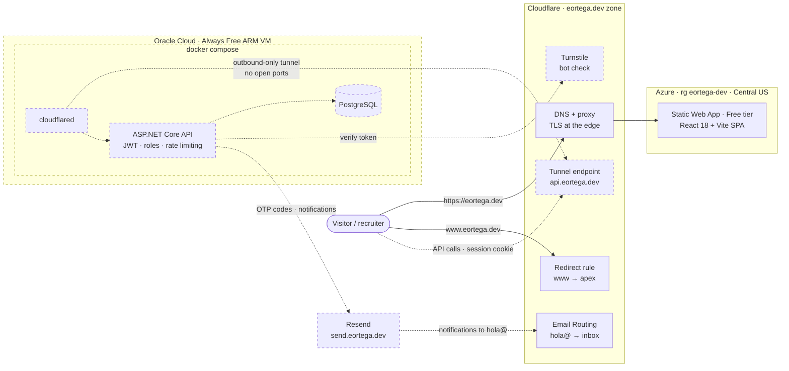
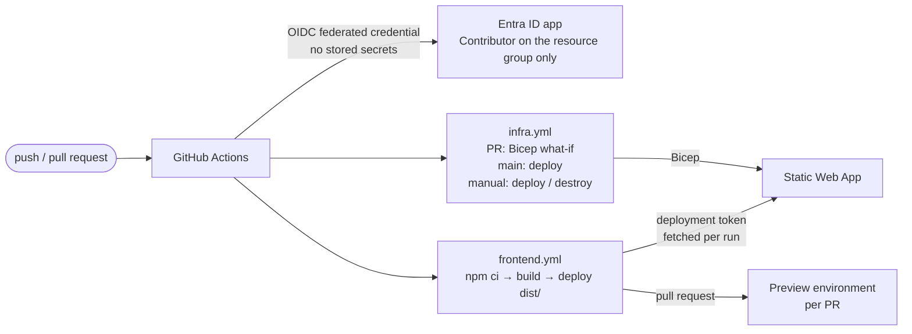
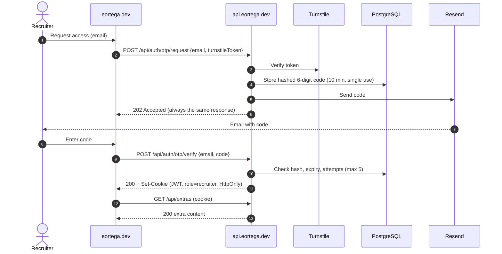

# eortega.dev

Personal portfolio of Esteban Ortega — backend & platform engineering. Live at **[eortega.dev](https://eortega.dev)**.

The site itself is part of the portfolio: a static React frontend on Azure, an ASP.NET Core API on an Oracle Cloud VM behind a Cloudflare Tunnel, infrastructure as code, and keyless CI/CD with OIDC.

> **Status:** the frontend, DNS, email and CI/CD are live. The backend is designed but not built yet — it is shown below with dashed lines.

## Architecture



| Piece | Where | Cost |
|---|---|---|
| Frontend | Azure Static Web Apps (Free tier), Central US | $0 |
| Backend *(planned)* | Oracle Cloud Always Free VM (Ampere A1, 2 OCPU / 12 GB), Docker Compose | $0 |
| DNS, TLS, redirects, email forwarding, tunnel | Cloudflare | $0 |
| Domain | Cloudflare Registrar | ~$12/year |

Why a VM instead of serverless for the API: the portal has to answer instantly for whoever opens it, with no cold starts. Cloudflare Tunnel exposes it without a public IP or open inbound ports.

## CI/CD



- **Keyless auth:** workflows sign in to Azure through OIDC federated credentials; the only identity they use has Contributor rights on a single resource group, not on the subscription.
- **Infrastructure as code:** [`infra/main.bicep`](infra/main.bicep) defines the Static Web App and its custom domain. Pull requests that touch `infra/` get a what-if summary; merges to `main` apply it.
- **Scale to zero:** `infra.yml` can be run manually with `destroy` to delete the Static Web App and with `deploy` to recreate it.
- **Previews:** every pull request gets its own preview environment, torn down when the PR closes.
- **Supply chain:** Dependabot security updates (vite and its plugin grouped together) and CodeQL analysis.

## Recruiter access *(planned)*

The whole site is public. Recruiters can optionally request a one-time code by email to unlock extra content — mostly a live look at the authentication they just went through (their own session claims, the flow, a protected endpoint returning 401 vs 200).



Two roles share the same JWT pipeline: `admin` (password login, manages projects) and `recruiter` (passwordless, read-only extras). Abuse of the code endpoint is limited with Turnstile plus per-IP and per-email rate limits.

## Repository layout

```
.github/
  workflows/frontend.yml   Build and deploy the SPA (production + PR previews)
  workflows/infra.yml      Bicep what-if / deploy / destroy
  dependabot.yml
infra/
  main.bicep               Static Web App + custom domain
  main.bicepparam
  bootstrap.sh             One-time setup: resource group, OIDC identity, repo variables
src/
  components/              One component + CSS module per section
  data/projects.js         Static project list until the API exists
```

## Local development

Requires Node `^20.19.0 || >=22.12.0`.

```bash
npm install
npm run dev      # http://localhost:5173
npm run build    # outputs to dist/
```

Setting up the Azure side from scratch: run [`infra/bootstrap.sh`](infra/bootstrap.sh) once (Git Bash, signed in with `az` and `gh`), then let `infra.yml` deploy the Bicep template.
